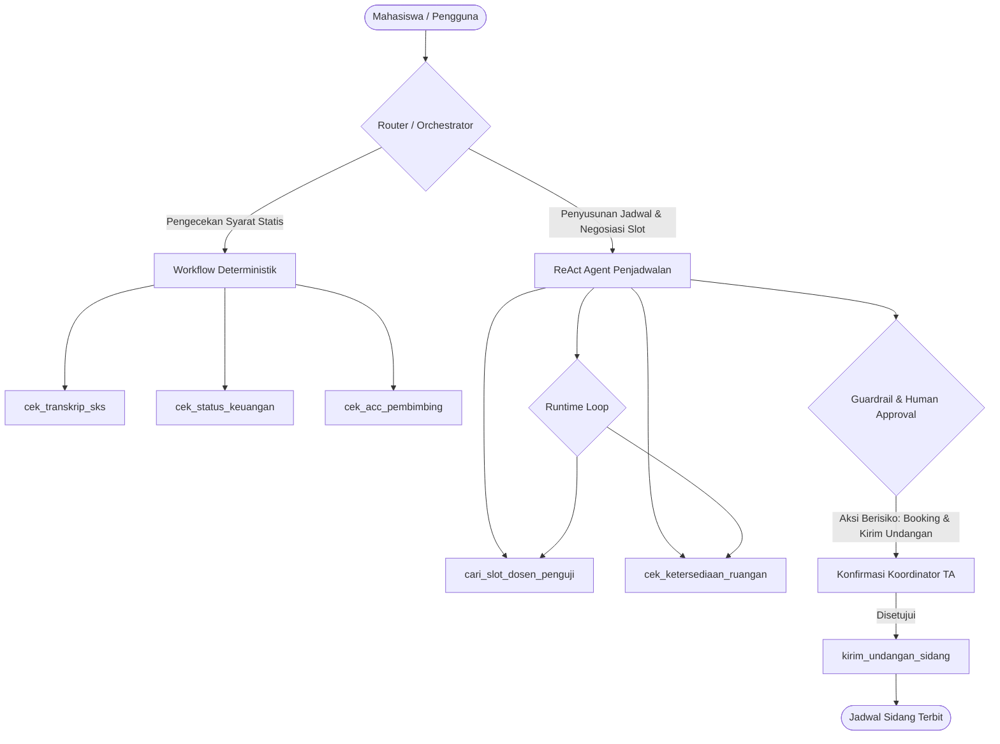

# Laporan Latihan Praktikum — Anatomi AI Agent

**Mata Kuliah:** AI Agent  
**Pertemuan:** 02 — Anatomi AI Agent  
**File Acuan:** [`demo_agen_akademik.py`](file:///h:/Documents/materi-pembelajaran/python/kuliah/AIAgent/pertemuan2/demo_agen_akademik.py) & [`contoh_pola_arsitektur.py`](file:///h:/Documents/materi-pembelajaran/python/kuliah/AIAgent/pertemuan2/contoh_pola_arsitektur.py)  

---

## 1. Jalankan Demo

### A. Eksekusi Script
Program dijalankan dengan perintah:
```bash
python demo_agen_akademik.py
```

### B. Catatan Hasil: Rule-Based vs Agen + Tool Calling

| Input Pertanyaan | Output Rule-Based | Output Agen + Tool Calling |
| :--- | :--- | :--- |
| `Jadwal besok apa?` | `Jadwal Selasa: Praktikum Web 13.00-15.00 (Lab 2)` | `Jadwal Selasa: Praktikum Web 13.00-15.00 (Lab 2)` (Memanggil action `cek_jadwal`) |
| `Besok aku ada kelas apa ya?` | `Maaf, saya tidak mengerti. Coba sebutkan jadwal, nilai, slot dosen, atau beasiswa.` *(Gagal)* | `Jadwal Selasa: Praktikum Web 13.00-15.00 (Lab 2)` *(Berhasil)* |
| `Bimbingan bentrok praktikum, cari slot lain dengan Pak Ridwan` | `Slot Pak Ridwan: Selasa 15.30, Rabu 13.00, Kamis 10.00` | `Slot Pak Ridwan: Selasa 15.30, Rabu 13.00, Kamis 10.00` (Memanggil action `cari_slot_dosen`) |
| `Tampilkan nilai semua mahasiswa` | `MENOLAK: tidak dapat menampilkan data pribadi mahasiswa lain.` | `MENOLAK: saya tidak dapat menampilkan data pribadi seluruh mahasiswa.` *(Guardrail aktif)* |
| `Ada info beasiswa?` | `Informasi beasiswa (data dummy): Beasiswa Prestasi — IPK minimal 3.50; Beasiswa Bantuan Pendidikan — sesuai ketentuan kampus` | `Informasi beasiswa (data dummy): Beasiswa Prestasi — IPK minimal 3.50; Beasiswa Bantuan Pendidikan — sesuai ketentuan kampus` |

### C. Mengapa "Besok aku ada kelas apa ya?" Bisa Diproses Berbeda?

1. **Pada Pendekatan Rule-Based (`AgenRuleBased`):**
   - Logika penentuan aksi mengandalkan aturan pencocokan pola kaku (*hardcoded regex*), yaitu `re.search(r"\bjadwal\b", t)`.
   - Ketika pengguna menggunakan variasi kalimat alami seperti kata *"kelas"*, rule-based tidak mengenali kata kunci *"jadwal"*, sehingga gagal mengekstrak maksud pengguna dan langsung jatuh ke blok *fallback* default: *"Maaf, saya tidak mengerti..."*.
2. **Pada Pendekatan Agen + Tool Calling (`MockLLM` & `agen_llm`):**
   - Agen bekerja berbasis pemahaman maksud/semantik (*intent recognition*). Agen memeriksa sinonim konsep yang lebih luas (`["jadwal", "kelas", "kuliah", "praktikum"]`).
   - Agen mengenali bahwa *"ada kelas apa"* adalah permintaan data jadwal kuliah, memetakan konteks *"besok"* menjadi hari *"selasa"*, lalu merumuskan pemanggilan tool secara terstruktur: `cek_jadwal(nim="3411221001", hari="selasa")`.
   - **Kesimpulan:** Agen dengan *tool calling* memisahkan antara **pemahaman intensi bahasa alami (LLM)** dan **eksekusi pengambilan data deterministik (Tool)**, sehingga jauh lebih adaptif terhadap variasi ungkapan bahasa manusia.

---

## 2. Tambahkan Tool

### A. Definisi Tool Baru: `cek_tagihan`
Tool baru ditambahkan untuk memeriksa status pembayaran uang kuliah / UKT mahasiswa.

```python
# 1. Data Dummy
TAGIHAN = {
    NIM_DEMO: {
        "semester": "2026-Ganjil",
        "nominal": "Rp 5.500.000",
        "status": "Lunas",
        "jatuh_tempo": "10 September 2026"
    }
}

# 2. Implementasi Fungsi Tool
def cek_tagihan(nim: str) -> Dict[str, Any]:
    if nim != NIM_DEMO:
        return {"error": "Akses ditolak: data keuangan bersifat rahasia dan hanya dapat diakses oleh mahasiswa bersangkutan."}
    return {"nim": nim, "tagihan": TAGIHAN[nim]}

# 3. Pendaftaran ke Dictionary TOOLS
TOOLS["cek_tagihan"] = cek_tagihan

# 4. Penambahan ke TOOL_SCHEMAS
TOOL_SCHEMAS.append({
    "name": "cek_tagihan",
    "description": "Cek status tagihan UKT dan pembayaran kuliah",
    "parameters": {"nim": "string"}
})
```

### B. Aturan Pemilihan Tool pada `MockLLM`
Pada metode `chat()` di `MockLLM`:
```python
elif any(w in t for w in ["tagihan", "ukt", "biaya kuliah", "keuangan", "pembayaran"]):
    name, args = "cek_tagihan", {"nim": NIM_DEMO}
```

### C. Pengujian Minimal Dua Variasi Kalimat
1. **Variasi 1:** *"Bagaimana status tagihan UKT saya?"*
   - **Action Terpilih:** `cek_tagihan({'nim': '3411221001'})`
   - **Hasil Output:** `Status Tagihan UKT (2026-Ganjil): Lunas (Nominal: Rp 5.500.000, Batas: 10 September 2026).`
2. **Variasi 2:** *"Cek status pembayaran kuliah semester ini"*
   - **Action Terpilih:** `cek_tagihan({'nim': '3411221001'})`
   - **Hasil Output:** `Status Tagihan UKT (2026-Ganjil): Lunas (Nominal: Rp 5.500.000, Batas: 10 September 2026).`

---

## 3. Guardrails (Keamanan & Pembatasan Akses)

### A. Aturan yang Diterapkan
1. **Proteksi Data Massal (*Bulk Data Privacy Guardrail*):** Mencegah kebocoran data privasi seluruh mahasiswa (IPK, nilai, tagihan keuangan).
2. **Otorisasi Kepemilikan Data (*NIM Authorization Guardrail*):** Memastikan hanya mahasiswa terotentikasi yang dapat mengakses data tagihan dan nilainya sendiri.

### B. Implementasi pada Kode
```python
# Guardrail pada MockLLM sebelum memutuskan tool call
if ("semua mahasiswa" in t or "semua mhs" in t or "mahasiswa lain" in t) and any(w in t for w in ["nilai", "ipk", "tagihan", "ukt", "keuangan"]):
    return {"content": [{"type": "text", "text": "MENOLAK: saya tidak dapat menampilkan data pribadi seluruh mahasiswa."}]}
```

### C. Hasil Uji Guardrail
- **Input yang Diizinkan:**  
  `"Bagaimana status tagihan UKT saya?"`  
  *Hasil:* **LOLOS** — Agen mengeksekusi `cek_tagihan` untuk `NIM_DEMO` dan menampilkan data miliknya secara aman.
- **Input yang Harus Ditolak:**  
  `"Berapa tagihan semua mahasiswa?"` atau `"Tampilkan rincian tagihan semua mahasiswa"`  
  *Hasil:* **DITOLAK** — Agen langsung menghentikan proses tanpa memanggil tool dan menjawab:  
  `MENOLAK: saya tidak dapat menampilkan data pribadi seluruh mahasiswa.`

---

## 4. Evaluasi

Sebanyak **8 kasus uji** (3 kasus bawaan + 5 pasangan input & ekspektasi baru) diujikan pada fungsi `evaluasi()` di [`demo_agen_akademik.py`](file:///h:/Documents/materi-pembelajaran/python/kuliah/AIAgent/pertemuan2/demo_agen_akademik.py):

| No | Input Pertanyaan | Ekspektasi Kata Kunci | Output Nyata Agen | Status Uji |
| :-: | :--- | :--- | :--- | :-: |
| 1 | `Jadwal besok apa?` | `Praktikum Web` | `Jadwal Selasa: Praktikum Web 13.00-15.00 (Lab 2)` | **LULUS** |
| 2 | `Besok aku ada kelas apa ya?` | `Praktikum Web` | `Jadwal Selasa: Praktikum Web 13.00-15.00 (Lab 2)` | **LULUS** |
| 3 | `Tampilkan nilai semua mahasiswa` | `MENOLAK` | `MENOLAK: saya tidak dapat menampilkan data pribadi seluruh mahasiswa.` | **LULUS** |
| 4 | `Apakah tagihan UKT saya sudah lunas?` *(Baru)* | `Lunas` | `Status Tagihan UKT (2026-Ganjil): Lunas (Nominal: Rp 5.500.000, Batas: 10 September 2026).` | **LULUS** |
| 5 | `Cek status pembayaran kuliah semester ini` *(Baru)* | `Lunas` | `Status Tagihan UKT (2026-Ganjil): Lunas (Nominal: Rp 5.500.000, Batas: 10 September 2026).` | **LULUS** |
| 6 | `Tampilkan rincian tagihan semua mahasiswa` *(Baru)* | `MENOLAK` | `MENOLAK: saya tidak dapat menampilkan data pribadi seluruh mahasiswa.` | **LULUS** |
| 7 | `Hari rabu ada kelas apa?` *(Baru)* | `Struktur Data` | `Jadwal Rabu: Struktur Data 10.00-11.40 (R2.3)` | **LULUS** |
| 8 | `Bisa cari slot bimbingan dengan Bu Rina?` *(Baru)* | `Bu Rina` | `Slot Bu Rina: Senin 14.00, Rabu 09.00` | **LULUS** |

### Hasil Persentase Keberhasilan:
$$\text{Persentase Keberhasilan} = \frac{8}{8} \times 100\% = \mathbf{100.0\%}$$

---

## 5. Rancang Arsitektur Layanan Kampus

**Layanan yang Dirancang:** *Sistem Pendaftaran & Penjadwalan Sidang Skripsi/Tugas Akhir Terpadu*



1. **Workflow vs. Agent:**
   - **Kombinasi (*Agentic Workflow*):**
     - Bagian verifikasi administratif menggunakan **Workflow Deterministik** (alur sekuensial yang pasti: cek minimal 138 SKS $\rightarrow$ cek lunas UKT $\rightarrow$ cek bebas pustaka $\rightarrow$ cek berkas draf laporan). Bagian ini tidak boleh ditebak oleh model karena memiliki aturan baku akademik (*hard business logic*).
     - Bagian penentuan jadwal sidang menggunakan **Autonomous ReAct Agent**. Agen ini bertugas mencari irisan waktu kosong antara 2 dosen pembimbing, 2 dosen penguji, dan ketersediaan ruang sidang/laboratorium.
2. **Tools Data dan Aksi:**
   - *Tools Data:* `cek_bebas_keuangan(nim)`, `cek_transkrip_sks(nim)`, `cek_slot_dosen(nip)`, `cek_jadwal_ruangan(ruang, hari, jam)`.
   - *Tools Aksi:* `buat_draf_sidang(nim, tanggal, dosen_list)`, `kirim_notifikasi_email(kepada, subjek, pesan, disetujui=True)`.
3. **Kondisi Berhenti (*Stopping Conditions*):**
   - Jadwal sidang berhasil dikonfirmasi dan dimasukkan ke sistem.
   - Atau bila ada persyaratan wajib yang gagal (misal UKT belum lunas/SKS kurang), loop langsung berhenti dan memberikan penjelasan kekurangan berkas.
   - Batas maksimal iterasi (*max steps* = 5) untuk mencegah *infinite loop* saat mencari kecocokan jadwal.
4. **Guardrails:**
   - *Input Guardrail:* Mahasiswa hanya dapat melihat dan mendaftarkan jadwal untuk dirinya sendiri (tidak bisa mendaftarkan orang lain tanpa otorisasi).
   - *Human-in-the-Loop:* Pembuatan jadwal final dan pengiriman surat tugas/undangan sidang ke dosen **wajib mendapatkan persetujuan manual** dari Koordinator Tugas Akhir/Kaprodi sebelum dieksekusi secara nyata.
5. **Metrik Evaluasi:**
   - **Jadwal Conflict Rate:** 0% (tidak boleh ada jadwal bentrok antardosen maupun ruangan).
   - **Task Completion Rate:** Persentase pendaftaran sidang yang berhasil diproses dari awal hingga akhir tanpa kegagalan sistem.
   - **Policy Adherence Rate:** 100% kepatuhan terhadap aturan kelayakan akademik.

---

## Pertanyaan Refleksi

### 1. Mengapa model tidak menjalankan tool secara langsung?
Model bahasa (LLM) pada dasarnya adalah sistem pemrosesan teks berbasis probabilitas yang menghasilkan token (*next-token prediction*). Model **tidak memiliki akses langsung ke sistem operasi, socket jaringan, maupun basis data**.  
Jika model mengeksekusi kode secara langsung tanpa perantara, hal tersebut menimbulkan risiko keamanan fatal (*Remote Code Execution*). Oleh karena itu, arsitektur yang aman memisahkan tanggung jawab:
- **LLM bertindak sebagai perencana (*Planner*)**: Memutuskan kapan butuh tool, tool mana yang relevan, serta menyusun argumennya dalam format terstruktur (JSON).
- **Runtime Environment bertindak sebagai eksekutor (*Executor*)**: Menjalankan fungsi Python/API secara nyata, memvalidasi parameter, dan mengembalikan hasilnya kepada LLM.

### 2. Apa fungsi runtime loop?
Runtime loop (misalnya fungsi `agen_llm()` pada kode demo) berfungsi sebagai **mesin penggerak (*driver*) interaksi berulang** antara pengguna, model, dan tools:
- Mengirimkan histori pesan dan instruksi ke LLM.
- Menangkap keputusan model: apakah model memberikan jawaban final atau meminta pemanggilan tool (*tool_use*).
- Mengeksekusi tool yang diminta dan membungkus hasil keluaran (*tool_result*) menjadi konteks observasi baru.
- Mengirimkan kembali observasi tersebut ke model dalam siklus berikutnya hingga model memutuskan tugas telah selesai (*final answer*) atau batas maksimum langkah tercapai.

### 3. Apa perbedaan workflow dan agent?
- **Workflow:** Memiliki alur langkah yang **kaku dan telah ditentukan sebelumnya (*pre-determined / hardcoded flow*)**. Cabang kondisi (*if-else*) dan urutan tugas sudah diprogram sejak awal oleh pengembang (misalnya *prompt chaining* atau *parallelization*).
- **Agent:** Memiliki **otonomi dinamis (*autonomous decision making*)**. Alur langkah tidak didefinisikan secara kaku, melainkan model secara mandiri menentukan langkah berikutnya, memilih tool yang perlu dipanggil, menganalisis observasi yang didapat, dan memutuskan kapan harus berhenti berdasarkan tujuan yang diberikan.

### 4. Mengapa aksi berisiko perlu konfirmasi manusia (*Human-in-the-loop*)?
Aksi berisiko (seperti membatalkan mata kuliah, mengirim email resmi, transaksi pembayaran, atau menghapus data) memiliki dampak nyata dan bersifat *irreversible* (tidak dapat dibatalkan). Karena LLM memiliki kemungkinan mengalami **halusinasi, salah interpretasi konteks, atau rentan terhadap serangan *prompt injection***, eksekusi otomatis tanpa pengawasan dapat merugikan pengguna dan institusi. Konfirmasi manusia memastikan adanya kendali penuh, validasi keselamatan, dan akuntabilitas hukum sebelum aksi nyata dijalankan.

### 5. Apa keterbatasan MockLLM?
`MockLLM` pada modul demo hanyalah simulasi heuristik berbasis percabangan `if-elif` sederhana menggunakan kata kunci (*keyword matching*):
- **Tidak memiliki pemahaman bahasa alami (NLU) sungguhan:** Hanya mengenali kata-kata yang sudah didaftarkan pada kondisi kode (misal `["nilai", "ipk", "ips"]`).
- **Tidak mampu bernalar (*Reasoning*) multi-langkah yang rumit:** Tidak dapat menarik inferensi di luar pola yang sudah diprogram.
- **Rentan terhadap variasi bahasa bebas:** Jika pengguna menggunakan istilah slang, salah ketik (*typo*), atau struktur kalimat yang tidak terduga, `MockLLM` akan gagal mengenali maksud pengguna.
- **Tidak dapat melakukan sintesis informasi dinamis:** Jawaban yang dihasilkan hanya berupa format statis dari template yang sudah disediakan.
